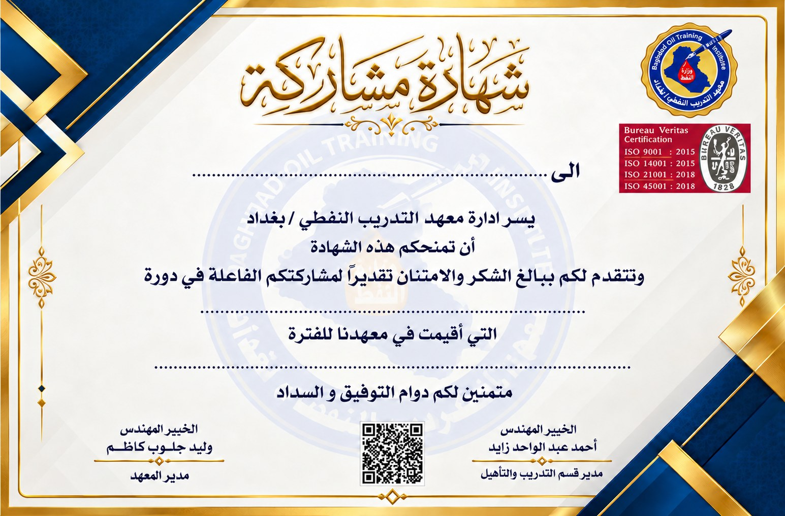

# منصة إصدار شهادات المشاركة لقسم التدريب والتأهيل
**تصميم وتطوير المبرمجة / ايمان عادل جاسم العكيلي - رئيس مبرمجين اقدم اول | معهد التدريب النفطي / بغداد**

تحوّل المنصة قائمة المشاركين في الدورة إلى شهادات مشاركة تحمل أسماءهم على قالب القسم المعتمد. يُدخل موظف عنوان الدورة وفترتها مرة واحدة اضافة الى اسماء المشاركين كل اسم في سطر واحد ، ثم تظهر له 
الشهادة الأولى ويُصدر شهادات الدفعة من المتصفح.

## طريقة الاستخدام

1. افتح رابط المنصة في المتصفح مع اتصال بالإنترنت لقراءة الملف وإنشاء الشهادات.
2. ارفع ملف بيانات الدورة، أو اكتب اسم الدورة وفترتها في الحقلين المخصصين وأدخل أسماء المشاركين، كل اسم في سطر.
3. راجع الحقول المستخرجة ومعاينة أول شهادة. يمكنك تعديل البيانات أو تغيير الخط، وتعطيل تصحيح الهمزات والمسافات إذا أردت الحفاظ على كتابة الاسم الرسمية.
4. اختر طريقة التنزيل من الزرّين أسفل المعاينة.

| الزر | ما تحصل عليه |
| --- | --- |
| تحميل الأول PDF | شهادة المشارك الأول في ملف PDF يحمل اسمه. |
| تحميل كل الشهادات PDF | ملف مضغوط واحد باسم <code>certificates.zip</code>، يضم شهادة PDF مستقلة باسم كل مشارك. |

## تجربة ببيانات افتراضية
نزّل [ملف الدورة التجريبي](/course.pdf) ثم ارفعه إلى المنصة. يظهر عنوان «Power Point» في حقل الدورة، ويظهر اسم المشارك عامر مطر رسن في معاينة الشهادة الأولى. بعد تنزيل الدفعة وفك الضغط ستجد 21 شهادة.

عند تجهيز ملفك، اكتب «اسم الدورة:» ثم العنوان، و«تاريخ الدورة:» ثم الفترة. اكتب بعدها الأسماء، كل اسم في سطر. تدعم نسخة المتصفح ملفات Word بصيغة DOCX وملفات PDF ذات النص القابل للاستخراج. إذا كان الملف صورة ممسوحة ضوئيًا، استخدم الإدخال المباشر.

## واجهة المنصة

توضح الصورة كيف تظهر بيانات دورة Power Point وأسماء المشاركين بعد رفع الملف، مع معاينة الشهادة الأولى وخياري تنزيلها أو تنزيل شهادات جميع المشاركين.

## الأثر العملي

تختصر المنصة وقت إعداد شهادات المشاركة في قسم التدريب والتأهيل. فبمجرد إدخال بيانات الدورة مرة واحدة أو رفع ملف المشاركين، تُدرج المنصة اسم كل مشارك وبيانات الدورة في قالب الشهادة المعتمد. ويستطيع موظف القسم معاينة الشهادة الأولى قبل إصدار الدفعة كاملة، مما يساعده على مراجعة البيانات وتقليل أخطاء الإدخال المتكرر.

⸻⸻⸻⸻

## منصة شهادات التدريب والتأهيل — شهادات موحّدة وفق قالب القسم المعتمد، وملف PDF مستقل باسم كل مشارك يسهّل أرشفة الشهادات وتسليمها.

## قالب الشهادة المعتمد

